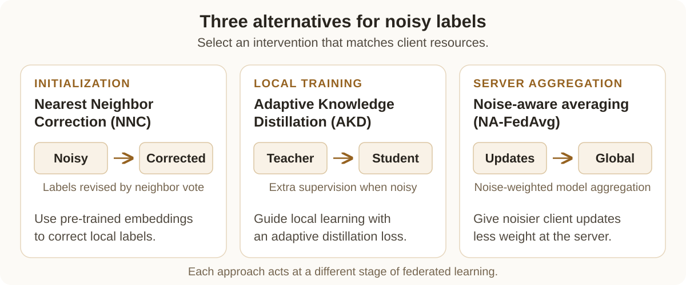

# FedLN

**Labeling Chaos to Learning Harmony: Federated Learning with Noisy Labels**

Vasileios Tsouvalas, Aaqib Saeed, Tanir Özçelebi, Nirvana Meratnia<br>
ACM Transactions on Intelligent Systems and Technology, 15(2), Article 22, 2024

[ Paper](https://doi.org/10.1145/3626242) · [ Project](https://nousphera.github.io/projects/fedln/) · [ Poster](https://nousphera.github.io/assets/posters/fedln-a0-landscape.pdf) · [Citation](#citation)

## Abstract

Client labels in federated learning vary in quality, making label noise difficult to address with a single training intervention. FedLN estimates noise locally and offers three complementary ways to handle it: nearest-neighbor label correction before training, adaptive knowledge distillation during local training, and noise-aware aggregation at the server. The framework supports vision and audio tasks and lets experiments select an intervention appropriate to the clients’ computational resources.

<a href="https://nousphera.github.io/projects/fedln/#overview">
  <picture>
    <source media="(prefers-color-scheme: dark)" srcset="docs/assets/readme/method-dark.svg">
    <source media="(prefers-color-scheme: light)" srcset="docs/assets/readme/method-light.svg">
    
  </picture>
</a>

*Choose an intervention to match the available client resources. [Play the animated method overview](https://nousphera.github.io/projects/fedln/#overview). Schematic based on Section 4.3 of the [journal paper](https://pure.tue.nl/ws/portalfiles/portal/320106480/3626242.pdf).*

## Installation

Use Python 3.11 and a dedicated virtual environment. The Flower simulation uses Flower 1.13.1 and Ray 2.10.0. Create both the checkout and environment on paths without spaces so Ray can start its workers. Install the pinned stack together to keep TensorFlow 2.15 and protobuf compatible.

```bash
mkdir -p "$HOME/research-code" "$HOME/.venvs"
cd "$HOME/research-code"
git clone https://github.com/Nousphera/FedLN.git
cd FedLN
python3.11 -m venv "$HOME/.venvs/fedln"
source "$HOME/.venvs/fedln/bin/activate"
python -m pip install -r requirements.txt
python -m pip check
```

## Data

```bash
python scripts/prepare_data.py --dataset cifar10 --root data --download
python scripts/prepare_data.py --dataset cifar10 --root data --validate
```

The [dataset guide](docs/DATA_SETUP.md) covers CIFAR-10/100, CIFAR-N,
FashionMNIST, PathMNIST, EuroSAT, and Speech Commands. NNC and AKD use aligned
teacher features; follow the [CLIP and TRILLsson guide](docs/PAPER_DATA.md) to
extract features and their source-identity manifests in the same environment.
CIFAR-N requires an explicit human-annotation key.

## Training

Start a two-client, two-round NNC simulation on generated data:

```bash
flwr run .
python scripts/check_run.py runs/flower-smoke --rounds 2
```

For prepared CIFAR-10 and extracted CLIP features, the 70% random-noise setting:

```bash
flwr run . paper --run-config "options='--method nnc --dataset_name cifar10 --data_root data --embeddings_dir $PWD/features --model_name resnet20 --num_clients 30 --num_rounds 200 --participation_rate .8 --train_epochs 1 --batch_size 128 --optimizer sgd --lr .1 --momentum .9 --knn_neighbors 100 --noisy_frac .8 --noise_level .7 --noise_sparsity 0 --seed 42 --output runs/cifar10-nnc'"
```

Methods include `nnc`, `akd`, `na_fedavg`, `fedavg`, `bi_tempered_loss`,
`label_smoothing`, and `confidence_learning`. Use
`python run.py --method METHOD --method-help` for each method's arguments.
The sequential runner accepts the same training options:

```bash
python run.py --method nnc --dataset_name synthetic --num_clients 2 \
  --num_rounds 2 --train_epochs 1 --batch_size 8 --knn_neighbors 5 --output runs/sequential
```

## Evaluation

Both runners evaluate the global model on the clean test split after each round.
The Flower run records accuracy in `rounds[].metrics.accuracy`; the sequential
runner records it in `rounds[].accuracy`. Values are fractions. Inspect the
saved evaluation from the CIFAR-10 command above:

```bash
python -m json.tool runs/cifar10-nnc/results.json
```

Use `--noise_sparsity 1` with a new output directory for the class-flipping
setting. [Method settings](docs/METHODS.md) document the noise generator and
method-specific options.

## Pretrained teachers

NNC and embedding-based AKD use [CLIP ViT-B/32](https://huggingface.co/openai/clip-vit-base-patch32)
for vision or [TRILLsson 3](https://tfhub.dev/google/nonsemantic-speech-benchmark/trillsson3/1)
for audio. The [teacher preparation guide](docs/PAPER_DATA.md) provides the
pinned model sources, feature extraction commands, and alignment checks.

## Configuration and outputs

Choose a new output directory for each run. `results.json` stores configuration,
runtime versions, client participation, example counts, and round metrics;
`final-parameters.npz` stores the evaluated global weights. Client caches persist
throughout the local Flower simulation. Final weight exports contain model
parameters; starting a new run initializes optimizer and client state.

Flower's `options` replaces the complete runner argument string. Set the selected
federation's `options.num-supernodes` to the same value as `--num_clients`.
See [Flower execution](docs/FLOWER_APP.md) for local worker resources and state.

[Method settings](docs/METHODS.md) specify noise generation, partitioning,
NA-FedAvg's energy threshold and capped weighting rule, and the two AKD
objectives. Teacher features must match the exact source content and row IDs.
The [testing guide](docs/TESTING.md) describes the regression and smoke checks.

## Results

Published CIFAR-10 / ResNet-20 test accuracy from [Table 3 of the journal paper](https://pure.tue.nl/ws/portalfiles/portal/320106480/3626242.pdf#page=20). There are 30 clients, 80% participation, 200 rounds, and one local epoch; 80% of clients have 70% label noise. Columns compare noise sparsity 0% and 100%. Values are means of three runs.

| Method | Random noise (%) | Class flipping (%) |
| --- | --- | --- |
| FedAvg | 57.65 | 63.54 |
| FedCorr | 67.27 | 65.23 |
| NNC | 74.76 | 54.59 |
| AKD (embeddings) | 68.43 | 68.39 |
| NA-FedAvg | 65.34 | 67.92 |

NNC is strongest under random noise; AKD and NA-FedAvg remain above FedAvg under both noise patterns. FedCorr includes its own preprocessing and fine-tuning schedule.

## Citation

If you use this work, please cite:

```bibtex
@article{tsouvalas2024fedln,
  author = {Tsouvalas, Vasileios and Saeed, Aaqib and Ozcelebi, Tanir and Meratnia, Nirvana},
  title = {Labeling Chaos to Learning Harmony: Federated Learning with Noisy Labels},
  journal = {ACM Transactions on Intelligent Systems and Technology},
  year = {2024},
  volume = {15},
  number = {2},
  articleno = {22},
  numpages = {26},
  doi = {10.1145/3626242},
  url = {https://doi.org/10.1145/3626242}
}
```

Machine-readable metadata: [CITATION.cff](CITATION.cff) · [BibTeX](citation.bib).

## License

[Apache-2.0](LICENSE). External datasets and pretrained models retain their own terms.
