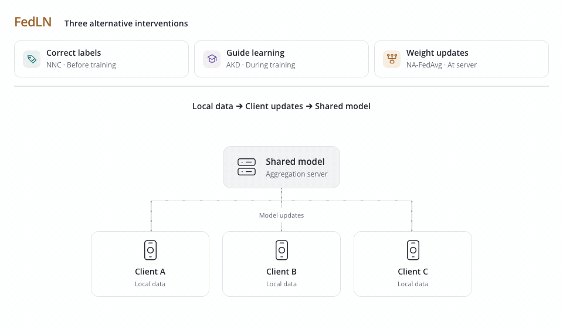

<h1 align="center">FedLN</h1>
<p align="center"><strong>Labeling Chaos to Learning Harmony:<br>Federated Learning with Noisy Labels</strong></p>
<p align="center"><a href="https://vtsouval.github.io/"><strong>Vasileios Tsouvalas</strong></a> · Aaqib Saeed · Tanir Özçelebi · Nirvana Meratnia</p>

<p align="center">
  <a href="https://doi.org/10.1145/3626242" title="Read the paper"></a>
  <picture></picture>
  <a href="https://nousphera.github.io/FedLN/" title="Explore the project"></a>
  <picture></picture>
  <a href="https://nousphera.github.io/assets/posters/fedln-a0-landscape.pdf" title="View the poster"></a>
</p>

## Abstract

**FedLN** addresses *label noise* in **Federated Learning (FL)** through three alternative interventions. **NNC** corrects labels using *pretrained embedding neighborhoods* before training. **AKD** guides noisy clients with *adaptive knowledge distillation* during local optimization. **NA-FedAvg** estimates noise from *prediction confidence* and weights updates at the server. Together, these approaches accommodate **different client resources** across vision and audio tasks, improving recognition under *synthetic and human annotation noise*.

<p align="center">
  <a href="docs/assets/readme/method-light.mp4" title="Watch the method video">
    <picture>
      <source media="(max-width: 600px) and (prefers-color-scheme: dark)" srcset="docs/assets/readme/method-dark-mobile.gif">
      <source media="(max-width: 600px)" srcset="docs/assets/readme/method-light-mobile.gif">
      <source media="(prefers-color-scheme: dark)" srcset="docs/assets/readme/method-dark.gif">
      
    </picture>
  </a>
</p>

## Setup

Create and activate the `fedln` environment:

```bash
git clone https://github.com/Nousphera/FedLN.git
cd FedLN
python3.12 -m venv --prompt fedln "$HOME/.venvs/fedln"
source "$HOME/.venvs/fedln/bin/activate"
```

From the activated `fedln` environment, install the requirements:

```bash
python -m pip install -r requirements.txt
```

## Data and Weights

Download, prepare and validate the datasets:

```bash
# One dataset
python scripts/prepare_data.py --dataset cifar10

# All datasets
python scripts/prepare_data.py
```

**Datasets:** `cifar10` · `fashionmnist` · `pathmnist` · `eurosat` · `spcm` · `cifar10n` · `cifar100n` · `cifar100`.

> [!NOTE]
> `spcm` prepares the 12-class Speech Commands v2 task. CIFAR-N uses human labels with clean test labels; CIFAR-10N defaults to `worse_label`. Select another annotation with `--human-noise-key` when preparing features and running experiments.

### Prepare Model

Prepare **CLIP** vision embeddings or **TRILLsson3** audio embeddings for NNC and AKD:

```bash
python scripts/prepare_model.py --dataset cifar10
```

Student models train from scratch: **ResNet20** for images and **CNN** for audio. Select `--model convmixer` for the paper's *ConvMixer-128/4* experiment.

## Run Experiments

From the repository root, launch your chosen method as a **Flower App**:

```bash
# Shared experiment settings
common=(--dataset cifar10 --nr-clients 30 --rounds 200
        --participation 0.8 --quantity-variation 0.25
        --local-epochs 1 --batch-size 128
        --noisy-clients 0.8 --noise-level 0.4 --noise-sparsity 0.7
        --device cuda)

# NNC (ours) · correct labels
python scripts/run_experiment.py "${common[@]}" --method nnc

# AKD (ours) · guide local training
python scripts/run_experiment.py "${common[@]}" --method akd

# NA-FedAvg (ours) · weight client updates
python scripts/run_experiment.py "${common[@]}" --method nafedavg --noise-round 25

# FedAvg
python scripts/run_experiment.py "${common[@]}" --method fedavg

# Label smoothing
python scripts/run_experiment.py "${common[@]}" --method label-smoothing

# Bi-tempered loss
python scripts/run_experiment.py "${common[@]}" --method bi-tempered

# Confident learning
python scripts/run_experiment.py "${common[@]}" --method confident-learning

# Centralized
python scripts/run_experiment.py "${common[@]}" --method centralized
```

> [!NOTE]
> NNC, AKD and NA-FedAvg are **separate interventions**. AKD also supports `--teacher global-logits`; noise detection still uses pretrained embeddings. NA-FedAvg collects scores from every client once, then resumes the selected participation rate.

## Citation

```bibtex
@article{tsouvalas2024fedln,
  author = {Tsouvalas, Vasileios and Saeed, Aaqib and Ozcelebi, Tanir and Meratnia, Nirvana},
  title = {Labeling Chaos to Learning Harmony: Federated Learning with Noisy Labels},
  journal = {ACM Transactions on Intelligent Systems and Technology},
  year = {2024},
  volume = {15},
  number = {2},
  articleno = {22},
  numpages = {26},
  doi = {10.1145/3626242},
  url = {https://doi.org/10.1145/3626242}
}
```

[License](LICENSE)
